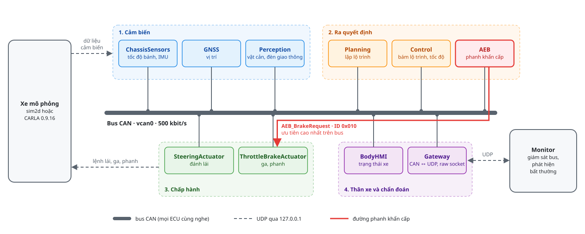
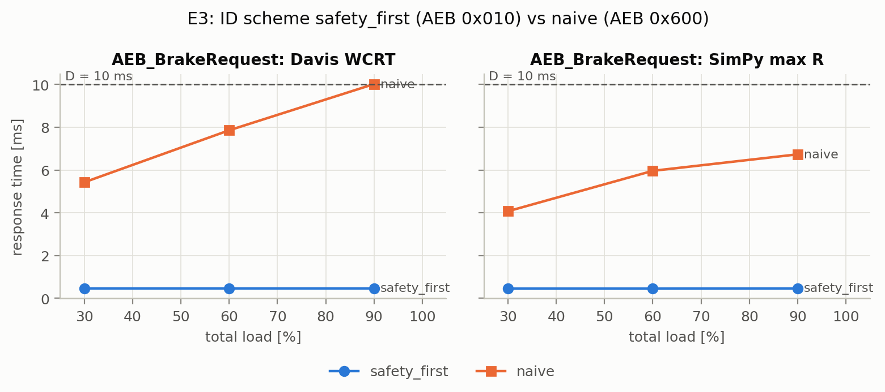

# Network Programming - CAN

Mạng CAN 10 nút cho xe tự hành mô phỏng: mỗi ECU là một tiến trình riêng chỉ giao tiếp qua CAN
(SocketCAN `vcan0`), xe được mô phỏng bằng `sim2d` hoặc CARLA. Dự án phân tích thời gian đáp ứng
(Davis WCRT), mô phỏng bus bằng SimPy để thử nghiệm bitrate/tải/lỗi, có gateway CAN↔UDP bằng raw
socket và bộ phát hiện bất thường dựa trên ngưỡng/thống kê.

Đồ án môn Lập trình mạng.

## Kiến trúc

Xe chạy theo một vòng khép kín: **cảm biến → ra quyết định → chấp hành → xe di chuyển → cảm biến**.
Mọi trao đổi giữa các ECU đều đi qua bus CAN.

<picture>
  <source media="(prefers-color-scheme: dark)" srcset="docs/images/architecture-dark.svg">
  
</picture>

**Chú thích:** mọi ECU cắm chung vào một bus CAN và nghe được mọi frame. Nét đứt là UDP qua
`127.0.0.1` giữa xe mô phỏng, ECU và monitor. Đường đỏ là lệnh phanh khẩn cấp: `AEB_BrakeRequest`
có ID nhỏ nhất (0x010) nên luôn thắng phân xử trên bus.

| Nhóm message | CAN ID | Chu kỳ | Gửi → Nhận |
|---|---|---|---|
| `AEB_BrakeRequest` | 0x010 | 10 ms | AEB → ThrottleBrakeActuator |
| `Steer_Cmd`, `ThrottleBrake_Cmd` | 0x100–0x101 | 10 ms | Control → Actuator |
| `WheelSpeed`, `IMU` | 0x200–0x201 | 10 ms | ChassisSensors → Planning, Control |
| `GNSS_Pose` | 0x210 | 100 ms | GNSS → Planning |
| `ObjectList_0..7`, `TrafficLight_Lane` | 0x300–0x310 | 50 ms | Perception → AEB, Planning |
| `TargetPath_0..1` | 0x400–0x401 | 50 ms | Planning → Control |
| `VehicleStatus` | 0x500 | 100 ms | BodyHMI → Gateway |
| `Diag_Request` / `Diag_Response` | 0x7DF / 0x7E8 | theo sự kiện | Gateway ↔ BodyHMI |

ID càng nhỏ thì ưu tiên càng cao. Danh sách đầy đủ ở `config/network/matrix.yaml`.

Toàn bộ mạng được định nghĩa ở một nơi là `config/network/matrix.yaml`. Từ file này, dự án sinh
ra file DBC (`make dbc`) và dùng chung cho hai tầng:

- **Tầng online**: các ECU chạy thật trên `vcan0`, nối với xe mô phỏng như sơ đồ trên.
- **Tầng SimPy**: mô hình bus CAN (phân xử, bit stuffing, lỗi, bus-off) dùng cho các thí nghiệm
  quét tham số. Kết quả ghi ra log `candump` cùng định dạng với tầng online để dùng chung một bộ
  phân tích.

Mọi kênh UDP chỉ dùng `127.0.0.1`, không mở cổng ra ngoài.

## Tính năng

- 20 message: 18 message định kỳ và 2 message chẩn đoán. Message định kỳ có bảo vệ E2E (CRC8 SAE
  J1850 + alive counter 4 bit).
- Phân tích thời gian đáp ứng xấu nhất theo Davis et al. (2007), tính bằng số hữu tỉ chính xác.
- Mô hình bus SimPy với thời gian tính bằng ns: phân xử theo ID, stuffing, lỗi theo xác suất/BER,
  bộ đếm TEC và bus-off, gateway nối hai bus.
- 9 ECU online với logic lái thật: Pure Pursuit + PI tốc độ, AEB theo TTC, watchdog đưa actuator
  về safe state.
- Gateway CAN↔UDP chỉ dùng raw socket (không dùng python-can), lấy timestamp từ kernel và gom
  frame (batching).
- Bộ phát hiện bất thường theo cửa sổ 100 ms cho 4 loại tấn công/lỗi: flood, silent, spoof,
  unknown_id.

## Yêu cầu hệ thống

| Thành phần | Ghi chú |
|---|---|
| Linux có module `vcan` | Cần SocketCAN; quyền root một lần sau mỗi lần khởi động máy để tạo `vcan0` |
| Python 3.10 | Ghim trong `.python-version` |
| [uv](https://docs.astral.sh/uv/) | Quản lý môi trường và thư viện |
| `can-utils` | `candump`, `cangen`, `canbusload` (chỉ cần cho phần online) |
| CARLA 0.9.16 server | Tùy chọn, chỉ cần cho `make demo-carla` |

Phần SimPy và toàn bộ test chạy được mà không cần `vcan0` hay CARLA.

## Cài đặt

```bash
git clone https://github.com/adungm75/NetworkProgramming-CAN.git
cd NetworkProgramming-CAN
make setup      # uv sync, kèm các extra: carla client, pyarrow
make test       # toàn bộ test, không cần vcan/CARLA
```

## Sử dụng

**Thí nghiệm SimPy và hình** (không cần quyền root):

```bash
make experiments figures   # E0-E5, E7, E8 + đánh giá E9 + bảng tiêu chí (~3 phút), rồi hình + docs/results.md
```

Kết quả: `results/` (không commit), `report/tables/*.csv`, `report/figures/*.png`, `docs/results.md`.

**Phần online trên `vcan0`:**

```bash
sudo scripts/setup_vcan.sh   # tạo vcan0 (thêm --vcan1 cho thí nghiệm hai bus)
make demo-2d                 # chạy toàn bộ stack với sim2d (120 s)
make experiments-online      # E0, E7, E8 online (~7 phút), rồi chạy lại: make figures
make gateway-bench           # đo độ trễ gateway theo batching (~3 phút)
make demo-carla              # cần CARLA 0.9.16 server đang chạy
```

Nếu chưa chạy phần online, bảng tiêu chí và các hình vẫn được sinh từ dữ liệu SimPy (các dòng/series
online bị bỏ qua). Bảng gateway (`report/tables/gateway_latency.csv`) đã được commit sẵn.

**Các lệnh Make khác:** `lint`, `dbc` (sinh lại file DBC), `theory` (bảng WCRT lý thuyết),
`sim-baseline`, `budget` (budget thời gian chuỗi AEB), `clean-results`.

## Kết quả chính

Toàn bộ số liệu, hình và kết luận theo từng tiêu chí nằm ở [`docs/results.md`](docs/results.md)
(sinh tự động). Một số kết quả nổi bật:

- Tải bus lý thuyết của ma trận baseline là **17.58 % ở 500 kbit/s**. Log `candump` trên `vcan0`
  đo được 17.56 %.
- Cả 18/18 ID định kỳ có thời gian đáp ứng mô phỏng lớn nhất không vượt WCRT Davis. WCRT của
  `AEB_BrakeRequest` (0x010) là **0.46 ms**.
- Bitrate thấp nhất mà mọi deadline vẫn đạt là **250 kbit/s**.
- Khi gán ID kiểu `naive` (AEB ở 0x600), WCRT của AEB tăng lên 10.02 ms ở 90 % tải, vượt deadline
  10 ms. Với `safety_first` (0x010), WCRT giữ ở 0.46 ms ở mọi mức tải.
- Bộ phát hiện bất thường (k = 3) trên dữ liệu online: FPR 0 % trên 1118 cửa sổ bình thường, TPR
  100 % với flood/silent/spoof và 99.01 % với unknown_id.
- Gateway với batch 1: độ trễ p50 0.26 ms, p99 0.81 ms; không mất gói UDP ở cả 6 cấu hình.



*Gán ID ảnh hưởng trực tiếp tới an toàn: khi AEB mang ID 0x600 (`naive`), thời gian đáp ứng xấu
nhất tăng theo tải và chạm deadline 10 ms ở 90 % tải. Với ID 0x010 (`safety_first`), nó giữ ở
0.46 ms ở mọi mức tải.*

## Cấu trúc thư mục

```
NetworkProgramming-CAN/
├── config/
│   ├── network/        # matrix.yaml (định nghĩa mạng), id_schemes.yaml
│   ├── dbc/            # canav.dbc (sinh tự động, không sửa tay)
│   ├── experiments/    # cấu hình thí nghiệm E0-E8, budget AEB
│   ├── online/         # tham số ECU, gateway
│   └── scenarios/      # kịch bản sim2d, CARLA Town02
├── src/canav/
│   ├── netdef/         # đọc và kiểm tra matrix.yaml, sinh DBC
│   ├── e2e/            # CRC8 + alive counter
│   ├── timing/         # tính bit frame, tải bus, Davis WCRT, budget AEB
│   ├── busmodel/       # mô hình bus CAN bằng SimPy
│   ├── experiments/    # chạy thí nghiệm, quét tham số, tạo anomaly
│   ├── ecu/            # 9 ECU online
│   ├── vehicle/        # sim2d, CARLA bridge, route
│   ├── sidechannel/    # kênh UDP giữa xe mô phỏng và ECU
│   ├── gateway/        # gateway CAN↔UDP (raw socket), giao thức CAV1
│   ├── monitor/        # bên nhận uplink của gateway
│   └── analysis/       # metric, đặc trưng, bộ phát hiện, tiêu chí, hình
├── scripts/            # tạo vcan, chạy stack, thí nghiệm online, đo gateway
├── tests/
├── docs/               # tài liệu kỹ thuật
└── report/             # hình, bảng CSV, bản nháp báo cáo
```

## Tài liệu

| File | Nội dung |
|---|---|
| [`docs/architecture.md`](docs/architecture.md) | Định nghĩa mạng, E2E, lý thuyết thời gian, mô hình SimPy, tầng online, CARLA |
| [`docs/gateway_protocol.md`](docs/gateway_protocol.md) | Giao thức CAV1, batching, phương pháp đo độ trễ |
| [`docs/experiments.md`](docs/experiments.md) | Thí nghiệm, tiêu chí, bộ phát hiện, giới hạn của phép đo |
| [`docs/results.md`](docs/results.md) | Hình, nhận xét và kết luận từng tiêu chí (sinh tự động) |
| [`report/draft/`](report/draft/) | Bản nháp báo cáo: thiết kế, phương pháp, kết quả, thảo luận |

## Giấy phép

Phát hành theo giấy phép [MIT](LICENSE). © 2026 Hoàng Anh Dũng.
