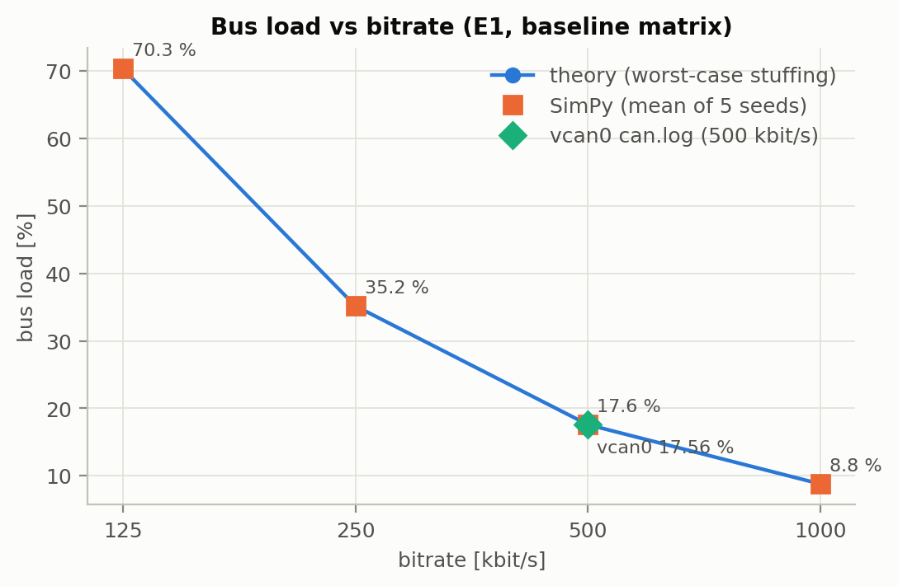
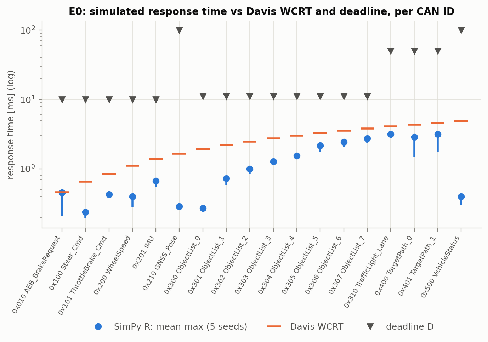
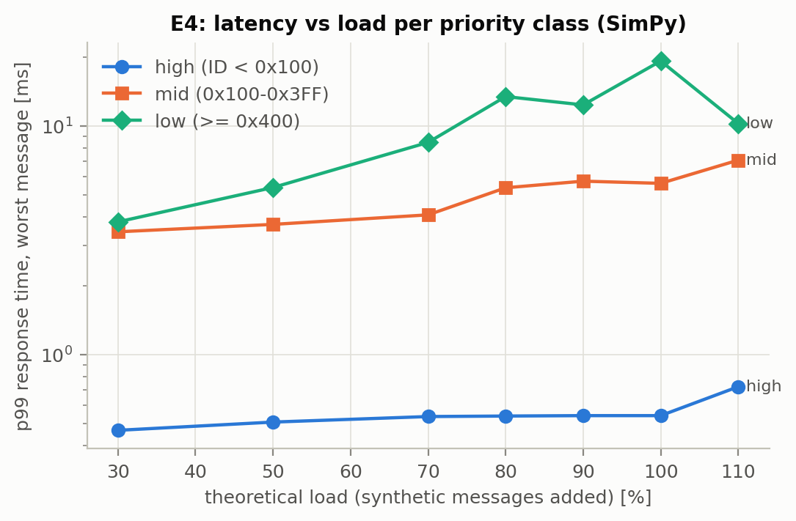
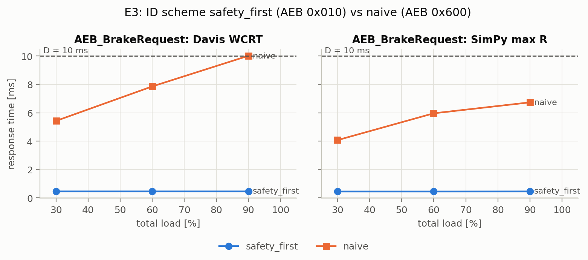
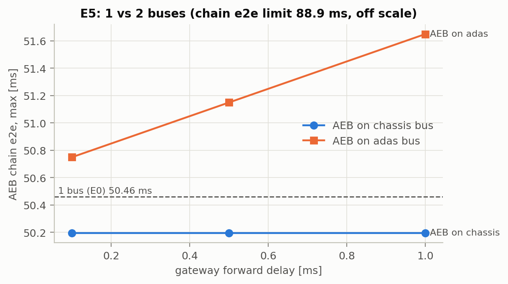
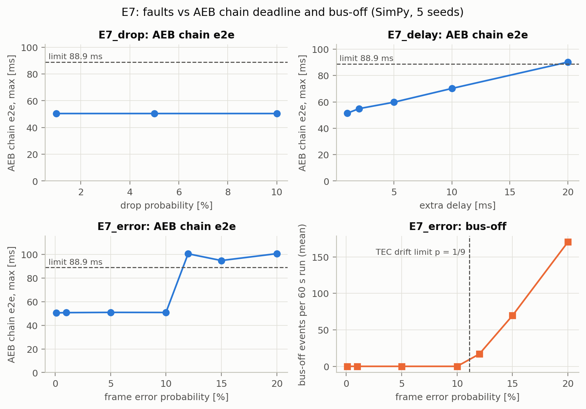
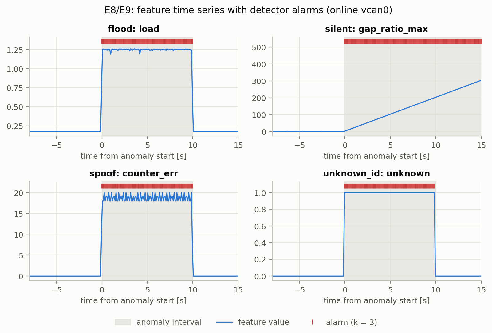
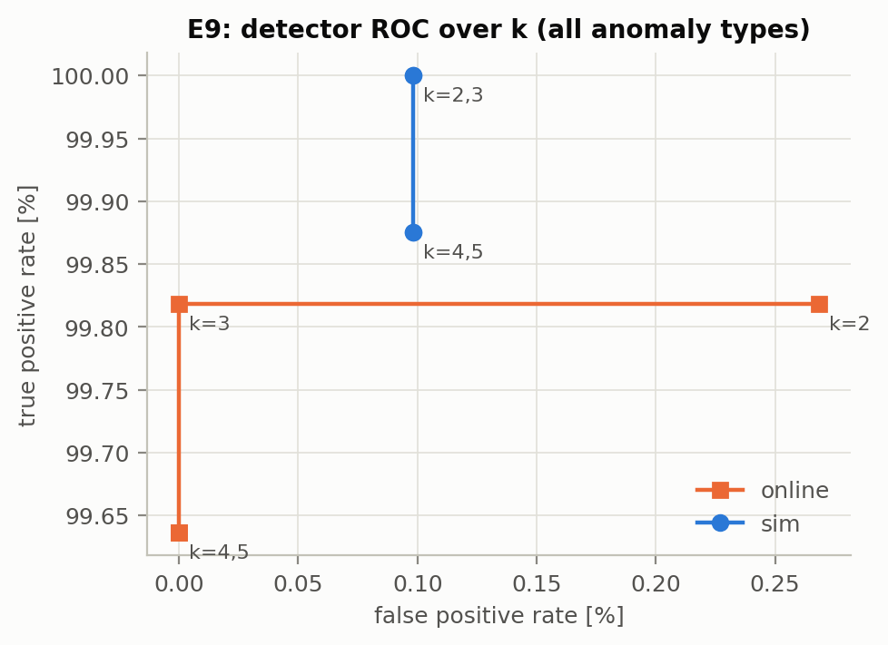
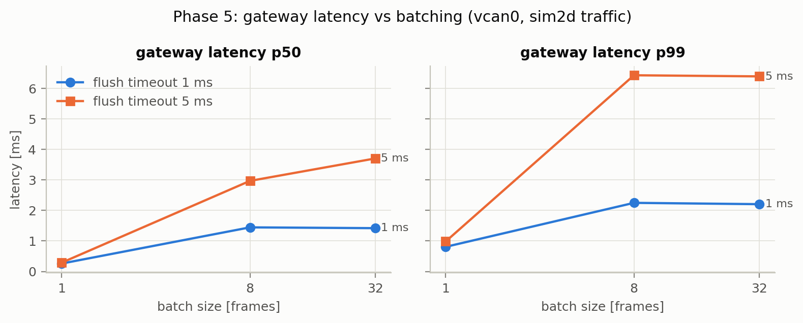

# Kết quả

Tài liệu này được sinh tự động bởi `python -m canav.analysis.results_doc` (`make figures`)
từ `results/` và `report/tables/`; mọi số dưới đây đều tính từ các file đó. Phương pháp và
giới hạn: `docs/experiments.md`.

## Hình 1. Tải bus theo bitrate (E1)

- Tải lý thuyết (stuffing worst-case) của ma trận baseline là 70.3 % ở 125 kbit/s, 17.58 % ở 500 kbit/s và 8.79 % ở 1 Mbit/s, tỉ lệ nghịch với bitrate.
- SimPy (trung bình 5 seed) lệch lý thuyết tối đa 0.0077 điểm phần trăm. Log candump trên vcan0 (E0 online) cho 17.56 % ở 500 kbit/s.

## Hình 2. Thời gian đáp ứng từng ID so với WCRT và deadline (E0)

- 18/18 ID có R_max mô phỏng ≤ WCRT Davis; R_max/D lớn nhất là 0.246 và độ dư nhỏ nhất D − WCRT là 7.30 ms.
- ObjectList_k mang D = 11.11 ms (budget chuỗi AEB ở 60 km/h) thay vì T = 50 ms; mọi ID khác D = T.

## Hình 3. Độ trễ theo tải và lớp ưu tiên (E4)

- Lớp ưu tiên cao (ID < 0x100) gần như không đổi: p99 0.47 ms ở 30 % và 0.72 ms ở 110 %; lớp thấp (≥ 0x400) tăng từ 3.81 ms lên 19.25 ms (lớn nhất trong dải).
- Từ 100 % tải, frame lớp thấp bị ghi đè trước khi gửi (6.5 % ở 100 %, 20.9 % ở 110 %), nên p99 của các frame còn gửi được không còn đại diện (p99 lớp thấp giảm ở 110 %).

## Hình 4. safety_first vs naive cho AEB_BrakeRequest (E3)

- Với `naive` (AEB ở 0x600), WCRT của AEB_BrakeRequest tăng từ 5.43 ms (30 %) lên 10.02 ms (90 %), vượt D = 10.00 ms; R_max mô phỏng ở 90 % là 6.73 ms.
- Với `safety_first` (0x010) WCRT giữ ở 0.46 ms ở mọi mức tải: chỉ còn phụ thuộc blocking của frame dài nhất.

## Hình 5. Một bus vs hai bus qua gateway (E5, P1)

- AEB ở bus chassis: e2e chuỗi AEB lớn nhất 50.20 ms ở mọi độ trễ gateway, thấp hơn 1 bus (50.46 ms) vì bus chassis ít tải hơn.
- AEB ở bus ADAS: AEB_BrakeRequest phải qua gateway, e2e tăng theo độ trễ gateway tới 51.65 ms ở 1 ms; vẫn dưới giới hạn 88.89 ms.

## Hình 6. Lỗi so với deadline chuỗi AEB và bus-off (E7)

- Trễ thêm ở mọi node đẩy e2e chuỗi AEB từ 51.46 ms (1 ms) lên 90.20 ms (20 ms), vượt giới hạn 88.89 ms.
- Bus-off xuất hiện từ xác suất lỗi 12 % (0 ở 10 %); ngưỡng trôi TEC p = 1/9 ≈ 11.1 % nằm trong khoảng này. Trung bình 170.4 lần bus-off mỗi run 60 s ở 20 %.
- Drop tới 10 % không đổi e2e chuỗi AEB (50.46 ms) vì e2e lấy origin mới nhất trong 8 frame ObjectList (giới hạn nêu ở `docs/experiments.md`).

## Hình 7. Đặc trưng theo thời gian và báo động (E8/E9)

- Nguồn: online vcan0. Mỗi loại anomaly làm một đặc trưng nhảy rõ trong khoảng anomaly: tải (flood), khoảng trống cùng ID / T (silent), lỗi counter (spoof), số ID lạ (unknown_id).
- Vạch đỏ là cửa sổ 100 ms có báo động (k = 3); số cửa sổ báo động nằm hẳn ngoài khoảng anomaly trong khung hình: flood 0, silent 0, spoof 0, unknown_id 0.

## Hình 8. ROC của bộ phát hiện theo k (E9)

- online k=2: FPR 0.268 %, TPR 99.82 %; online k=3: FPR 0.000 %, TPR 99.82 %; online k=4: FPR 0.000 %, TPR 99.64 %; online k=5: FPR 0.000 %, TPR 99.64 %; sim k=2: FPR 0.098 %, TPR 100.00 %; sim k=3: FPR 0.098 %, TPR 100.00 %; sim k=4: FPR 0.098 %, TPR 99.88 %; sim k=5: FPR 0.098 %, TPR 99.88 %.
- SimPy: FPR không đổi theo k; FPR trên các run không có anomaly là 0.000 % (báo động sai còn lại nằm ở các cửa sổ bình thường của run E8, xem `docs/experiments.md`).

## Hình 9. Độ trễ gateway theo batching (Phase 5)

- Batch 1: p50 0.26 ms, p99 0.81 ms; batch 32 với timeout 5 ms: p50 3.70 ms, p99 6.39 ms nhưng 5.8 frame/datagram thay vì 1.
- Mất gói UDP: 0 ở cả 6 cấu hình.

## Kết luận theo từng tiêu chí (`report/tables/criteria_summary.csv`)

| # | Thí nghiệm | Mục | Đo được | Ngưỡng | Kết luận |
|---|---|---|---|---|---|
| 1 | E0 | Davis WCRT <= D, all periodic IDs | 18/18 IDs, min slack 7.301 ms | R <= D | pass |
| 1 | E0 | simulated max R <= D, all IDs (5 seeds) | max R/D = 0.246 | R <= D | pass |
| 1 | E0 | AEB chain: per-hop R <= D (theory + sim) | theory pass, sim pass | D(ObjectList_k) = 11.111 ms, D(AEB_BrakeRequest) = 10.000 ms | pass |
| 1 | E0 | AEB chain e2e (sim, sensing origin -> AEB_BrakeRequest on bus) | 50.460 ms | <= 88.889 ms | pass |
| 4 | E0 | baseline E2E: instances lost / counter gaps (sim) | 0 lost, max counter loss 0.0000 | 0 | pass |
| 3 | E1 | lowest bitrate with every deadline met (theory + sim) | 250000 bit/s | all R <= D | breaking point at 250000 bit/s (breaking point between 250000 and 125000) |
| 3 | E2 | configurations where the AEB chain misses its deadline (('network.period_factor', 'network.dlc')) | period_factor=2.0,dlc=8: e2e 99.373 ms; period_factor=2.0,dlc=4: e2e 99.213 ms | per-hop D, e2e <= 88.889 ms | breaking point at: period_factor=2.0,dlc=8; period_factor=2.0,dlc=4 |
| 3 | E3 | configurations where the AEB chain misses its deadline (('network.scheme', 'network.target_load')) | scheme=naive,target_load=0.9: theory | per-hop D, e2e <= 88.889 ms | breaking point at: scheme=naive,target_load=0.9 |
| 3 | E4 | highest load with every deadline met (theory + sim) | 50 % (theoretical worst-case load) | all R <= D | breaking point at 0.5 (breaking point between 0.5 and 0.7) |
| 3 | E4 | highest load with every matrix (non-synthetic) message deadline met | 110 % | all R <= D | breaking point at 1.1 (none in sweep (all pass up to 1.1)) |
| 2 | E4 | highest schedulable load vs 50 % rule of thumb | 50 % (theoretical worst-case load) | >= 50% | pass |
| 2 | E4 | highest schedulable load vs 70 % reference | 50 % (theoretical worst-case load) | 70% | n/a (reference: below) |
| 3 | E5 | forward delay at which the AEB chain misses (AEB on adas) | max e2e 51.650 ms | e2e <= 88.889 ms | none in sweep (all pass up to 0.001) |
| 3 | E5 | forward delay at which the AEB chain misses (AEB on chassis) | max e2e 50.196 ms | e2e <= 88.889 ms | none in sweep (all pass up to 0.001) |
| 3 | E7_drop | highest fault rate before AEB chain miss or bus-off | no failure | AEB chain ok and no bus-off | none in sweep (all pass up to 0.1) |
| 3 | E7_delay | highest fault rate before AEB chain miss or bus-off | 0.02 s: AEB chain (e2e 90.196 ms) | AEB chain ok and no bus-off | breaking point between 0.01 and 0.02 |
| 3 | E7_error | highest fault rate before AEB chain miss or bus-off | 0.2: bus-off; 0.15: bus-off; 0.12: bus-off | AEB chain ok and no bus-off | breaking point between 0.1 and 0.12 |
| 4 | E7_drop | injected losses detected by the alive counter (sim, between delivered frames) | 35450 detected / 35450 lost (35471 drops injected) | all | pass |
| 4 | E0 online | baseline CRC + counter errors (vcan0) | 0 crc, 0 counter | 0 | pass |
| 4 | E7 online drop 5 % Control | drop runs detected as counter gaps at actuators | 440 detected / 440 drop runs | all | pass |
| 4 | E7 online silent Control | SteeringActuator enters safe state after the watchdog | 32.8 ms after the last command | > 30 ms (3 cycles of 10 ms) | pass |
| 4 | E7 online silent Control | ThrottleBrakeActuator enters safe state after the watchdog | 30.4 ms after the last command | > 30 ms (3 cycles of 10 ms) | pass |
| 6 | Phase 5 gateway | batch 1, flush 1.0 ms | p50 261 us, p99 808 us, UDP lost 0 | none | n/a |
| 6 | Phase 5 gateway | batch 1, flush 5.0 ms | p50 291 us, p99 985 us, UDP lost 0 | none | n/a |
| 6 | Phase 5 gateway | batch 8, flush 1.0 ms | p50 1445 us, p99 2248 us, UDP lost 0 | none | n/a |
| 6 | Phase 5 gateway | batch 8, flush 5.0 ms | p50 2967 us, p99 6426 us, UDP lost 0 | none | n/a |
| 6 | Phase 5 gateway | batch 32, flush 1.0 ms | p50 1419 us, p99 2205 us, UDP lost 0 | none | n/a |
| 6 | Phase 5 gateway | batch 32, flush 5.0 ms | p50 3704 us, p99 6390 us, UDP lost 0 | none | n/a |
| 4 | E8/E9 online | spoofed Steer_Cmd windows with E2E counter errors (R5) | 1.000 of 101 windows | 1.0 (every window) | pass |
| 7 | E8/E9 online | TPR flood (k = 3) | 1.0000 (101 windows), delay mean 0.061 s / max 0.061 s, missed 0/1 | none | n/a |
| 7 | E8/E9 online | TPR silent (k = 3) | 1.0000 (247 windows), delay mean 0.054 s / max 0.054 s, missed 0/1 | none | n/a |
| 7 | E8/E9 online | TPR spoof (k = 3) | 1.0000 (101 windows), delay mean 0.052 s / max 0.052 s, missed 0/1 | none | n/a |
| 7 | E8/E9 online | TPR unknown_id (k = 3) | 0.9901 (101 windows), delay mean 0.056 s / max 0.056 s, missed 0/1 | none | n/a |
| 7 | E8/E9 online | global FPR (k = 3) | 0.00000 (1118 normal windows) | none | n/a |
| 7 | E8/E9 online | ROC over k (FPR, TPR) | k=2: (0.00268, 0.9982); k=3: (0.00000, 0.9982); k=4: (0.00000, 0.9964); k=5: (0.00000, 0.9964) | none | n/a |
| 4 | E8/E9 sim | spoofed Steer_Cmd windows with E2E counter errors (R5) | 1.000 of 200 windows | 1.0 (every window) | pass |
| 7 | E8/E9 sim | TPR flood (k = 3) | 1.0000 (200 windows), delay mean 0.100 s / max 0.100 s, missed 0/2 | none | n/a |
| 7 | E8/E9 sim | TPR silent (k = 3) | 1.0000 (200 windows), delay mean 0.100 s / max 0.100 s, missed 0/2 | none | n/a |
| 7 | E8/E9 sim | TPR spoof (k = 3) | 1.0000 (200 windows), delay mean 0.100 s / max 0.100 s, missed 0/2 | none | n/a |
| 7 | E8/E9 sim | TPR unknown_id (k = 3) | 1.0000 (200 windows), delay mean 0.100 s / max 0.100 s, missed 0/2 | none | n/a |
| 7 | E8/E9 sim | global FPR (k = 3) | 0.00098 (5100 normal windows) | none | n/a |
| 7 | E8/E9 sim | ROC over k (FPR, TPR) | k=2: (0.00098, 1.0000); k=3: (0.00098, 1.0000); k=4: (0.00098, 0.9988); k=5: (0.00098, 0.9988) | none | n/a |
| 5 | E7 online (P1) | maximum avoidance speed vs drop/delay at Control/AEB | not run | - | n/a (P1, not run in Phase 6) |

Nguồn của mỗi ngưỡng nằm ở cột `threshold_source` của bảng CSV. `n/a`: tiêu chí không có ngưỡng (gateway, bộ phát hiện) hoặc chưa chạy (P1).
